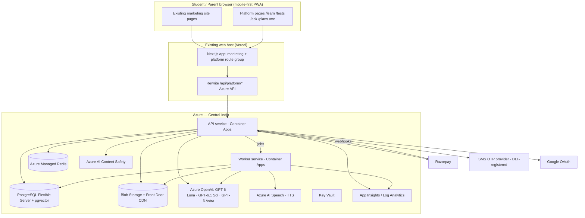

# SOYL Academy Learning Platform — Architecture

> Location in repo: `docs/platform/ARCHITECTURE.md`
> Product rules live in `docs/platform/CONTEXT.md`. If this document and CONTEXT.md disagree on a business rule, CONTEXT.md wins; flag the conflict.
> Decisions that change this document are recorded as ADRs in `docs/platform/adr/` and this file is updated in the same PR.
>
> Last updated: 25 Oct 2026

---

## 0. Principles

1. **Never break the marketing site.** All product code is additive and isolated (§2, §17).
2. **Backend on Azure, Central India.** Web pages are served by the existing web host (currently Vercel); everything stateful — API, workers, database, files, AI — runs in Azure.
3. **Boring, typed, testable.** TypeScript end to end; schemas validated at every boundary with zod.
4. **Content is data.** Lessons, questions, tests and blueprints are structured JSON validated by schemas — never hard-coded in components.
5. **Config, not code,** for prices, credits, model names, feature flags.
6. **Idempotent and resumable** pipelines and webhooks.
7. **Mobile-first, low-bandwidth-first.** Budget every kilobyte on student pages.
8. **Observable by default.** Every request traced; every AI call metered in INR.

---

## 1. System overview



**Request path:** browser → same-domain Next.js → rewrite `/api/platform/*` to the Azure API. Same-domain requests keep cookies first-party and avoid CORS.

---

## 2. Repository layout

The marketing app stays exactly where it is. Platform code is added beside it. **Adapt paths to what discovery finds** (record differences in `docs/platform/REPO_MAP.md` and an ADR).

```
/                              existing marketing app — DO NOT restructure
├── app/ (or src/app/)         existing routes
│   └── (platform)/            NEW route group: every product page + its own layout
├── components/platform/       NEW: product UI components (scoped styles)
├── platform/                  NEW: everything else for the product
│   ├── shared/                zod schemas, types, config (plans, credits, models, flags)
│   ├── api/                   Fastify API service (Docker → Azure Container Apps)
│   ├── worker/                background jobs (pg-boss) — same codebase conventions
│   ├── db/                    Drizzle schema, migrations, seed scripts
│   ├── catalog/               syllabus graph, subject lists, blueprints (YAML/JSON, in git)
│   │   └── sources/           official PDFs placed by the owner when fetch is impossible
│   ├── content-pipeline/      generation, verification, TTS, ingestion CLIs
│   ├── content-templates/     prompt templates, slide templates, exemplar chapters
│   ├── infra/                 Bicep modules + environment parameter files
│   ├── e2e/                   Playwright tests (platform flows + marketing regression)
│   └── load/                  k6 load tests
├── docs/platform/             CONTEXT.md, ARCHITECTURE.md, REPO_MAP.md, STATUS.md, adr/, handoffs/, runbooks/
├── CLAUDE.md
└── AGENTS.md
```

- Use the repo's existing package manager. Add `platform/*` as workspaces **without upgrading or changing marketing dependencies**.
- **Generated content is not stored in git** (it will be hundreds of MB). Git holds the catalog, blueprints, templates and a few exemplar chapters. Generated content lives in Postgres + Blob as versioned **content releases** (§7.4).
- If the marketing site is not Next.js App Router, the repo-cartographer writes an ADR proposing the closest equivalent (e.g. a separate `apps/platform-web` Next.js app mounted at the same domain via rewrites). Do not migrate the marketing site.

---

## 3. Web front end

### 3.1 Routes (all under the `(platform)` route group with its own layout)

| Route | Access | Rendering | Purpose |
|---|---|---|---|
| `/learn` | public | static | Board → class picker |
| `/learn/[board]/[class]` | public | static/ISR | Subjects |
| `/learn/[board]/[class]/[subject]` | public | static/ISR | Chapters, progress if logged in |
| `/learn/[board]/[class]/[subject]/[chapter]` | public | ISR | Chapter hub: lesson, notes, flashcards, practice, tests |
| `.../[chapter]/lesson` | public | ISR shell + client player | Slide player |
| `.../[chapter]/notes` | public | ISR | Notes (SEO-indexable) |
| `.../[chapter]/flashcards` | public | client | Flashcards |
| `.../[chapter]/practice` | public | client | Practice (guest progress in local storage) |
| `/tests` · `/tests/series/[board]/[class]/[subject]` | public list, login to start | client | Test series catalogue |
| `/tests/attempt/[attemptId]` | login | client | Test player |
| `/tests/result/[attemptId]` | login | client | Results, analysis, self/AI evaluation |
| `/tests/builder` | login | client | Custom test builder |
| `/tests/live/[eventId]` | login | client | All-India mock event |
| `/ask` | login for AI | client | AI tutor, photo doubts |
| `/plans` | public | static | AI plans + Razorpay checkout |
| `/me` | login | client | Profile, board/class, XP, streaks, badges, subscription, credits history |
| `/leaderboard` | login | client | Leagues |
| `/admin/*` | role: admin/reviewer | client | Content reports queue, inline content editor, config, user lookup |

### 3.2 Front-end rules
- Platform layout, styles and providers are **scoped to the route group**; no edits to the global stylesheet, root layout behaviour, or marketing components. Use CSS Modules or the repo's existing styling approach with a `platform-` namespace.
- Entry points from the marketing site (nav links, CTAs) are behind the `PLATFORM_ENABLED` flag.
- Typed API client generated from the API's OpenAPI spec into `platform/shared/api-client`.
- Server data via the API only; no direct DB access from Next.js.
- Fonts: existing site font + **Noto Sans Devanagari** for Hindi (subset, `font-display: swap`).
- KaTeX for maths (CSS loaded only on pages that need it). Chemistry structures via a client-side SMILES renderer, lazy-loaded.
- **Slide player:** keyboard + swipe navigation; progress bar; "read" mode (text visible) and "listen" mode (narration audio with text highlight); remember position; prefetch next 2 slides; works at 360 px width; images/diagrams lazy-loaded; download deck as PDF (generated server-side, cached).
- **Test player:** server-authoritative timer; autosave every 10 s and on every answer change/visibility change; resumes after refresh or network loss (local queue, retried); question palette (answered / marked / not visited); section navigation; submit confirmation; works offline for up to 10 minutes of answering.
- Guest progress stored in `localStorage` under `soyl_guest_v1`; merged via `POST /v1/me/merge-guest` on first login.
- Login prompt modal with return-to URL.
- SEO: public lesson, notes and chapter pages have titles, descriptions, canonical URLs and structured data; a **separate platform sitemap** is added to a sitemap index without altering how the marketing sitemap is produced.
- Accessibility: WCAG 2.1 AA for platform pages (contrast, focus, labels, alt text on diagrams via their `alt` field).

---

## 4. API service

- **Runtime:** Node.js LTS, **Fastify**, TypeScript, zod (via `fastify-type-provider-zod`), OpenAPI generated from routes.
- **ORM:** Drizzle + `drizzle-kit` migrations. Migrations run as a pre-deploy Container Apps job.
- **Jobs:** **pg-boss** (Postgres-backed queue) for content jobs, TTS, PDF export, evaluations, emails, reconciliation. Revisit with an ADR if throughput demands Azure Service Bus.
- **Versioned paths:** `/v1/...`. Errors use RFC 7807 problem+json.
- **Rate limits:** per IP and per user (Redis), stricter on auth and AI endpoints.

### 4.1 Modules and key endpoints

| Module | Key endpoints |
|---|---|
| auth | `/v1/auth/*` (handled by auth library), `GET /v1/session` |
| me | `GET/PATCH /v1/me` (board, class, school, display name), `POST /v1/me/merge-guest`, `DELETE /v1/me` |
| catalog | `GET /v1/catalog/boards`, `/v1/catalog/:board/:class/subjects`, `/v1/catalog/subjects/:id/chapters` |
| content | `GET /v1/chapters/:id` (hub), `/v1/chapters/:id/deck`, `/notes`, `/flashcards` |
| practice | `GET /v1/chapters/:id/practice?cursor=`, `POST /v1/practice/answers` |
| tests | `GET /v1/test-series?board&class&subject`, `POST /v1/tests/:id/attempts`, `PUT /v1/attempts/:id/responses` (batched autosave), `POST /v1/attempts/:id/submit`, `GET /v1/attempts/:id/result`, `POST /v1/tests/custom` |
| live | `GET /v1/live-events`, `POST /v1/live-events/:id/register`, `GET /v1/live-events/:id/leaderboard` |
| evaluation | `POST /v1/attempts/:id/self-evaluation`, `POST /v1/attempts/:id/ai-evaluation` (credits) |
| ai | `POST /v1/ai/:action` (streaming SSE), `GET /v1/ai/quote/:action` (credit cost), `POST /v1/ai/uploads` (sample papers, photos) |
| credits | `GET /v1/credits` (balance, reset time), `GET /v1/credits/ledger` |
| billing | `GET /v1/plans`, `POST /v1/billing/subscriptions`, `POST /v1/billing/orders`, `POST /v1/billing/cancel`, `POST /v1/webhooks/razorpay` |
| gamification | `GET /v1/me/progress`, `/v1/leaderboards/:scope`, `/v1/me/badges` |
| reports | `POST /v1/content-reports` |
| admin | `/v1/admin/reports`, `/v1/admin/content/:type/:id` (edit + republish), `/v1/admin/config`, `/v1/admin/users/:id` |
| health | `GET /healthz`, `GET /readyz` |

**Authorization:** every route declares its required role (`guest`, `student`, `parent`, `reviewer`, `admin`). A test asserts that every registered route has an explicit policy.

---

## 5. Authentication

- Library: **Better Auth** running inside the API (sessions in Postgres, httpOnly secure cookies). If an ADR finds a blocker, fall back to Auth.js with the same requirements.
- Methods: **Google sign-in**, **phone OTP** (Indian SMS provider with DLT-registered templates, e.g. MSG91), **email OTP** (Azure Communication Services Email or the repo's existing email provider).
- Session cookie on the main domain (requests arrive via the same-domain rewrite). `SameSite=Lax`, `Secure`, `HttpOnly`; CSRF protection on state-changing routes.
- Account linking by verified email/phone.
- **Parental consent:** integrate with the owner's existing consent system through an adapter interface `ConsentProvider` (`getStatus(userId)`, `startFlow(userId)`). Discovery must locate it; if it lives outside the repo, ask the owner for the integration contract. Gate behaviour follows that system's rules.
- Roles: `student` (default), `parent`, `reviewer`, `admin`. Admin bootstrap via a CLI seeding the owner's account.
- Account deletion endpoint deletes or anonymises personal data and revokes sessions.
- **Release requirement:** sign-up, login, logout, session refresh, account linking, guest merge and deletion all pass end-to-end tests on staging with real providers (test credentials) before launch.

---

## 6. Data model (PostgreSQL)

Logical groups (Drizzle schema in `platform/db/schema/*`). All tables have `id` (uuid v7), `created_at`, `updated_at`. Catalog and content tables carry `academic_year`.

**Identity:** `users`, `accounts` (auth providers), `sessions`, `verifications`, `profiles` (role, board, class, school_id, city, display_name, locale), `guardian_links`, `consent_status` (cached from ConsentProvider), `schools`.

**Catalog:** `boards`, `classes`, `subjects` (board, class, code, name, language, tier, wave), `chapters` (subject, number, title, part), `topics`, `learning_outcomes`, `syllabus_versions`.

**Content:** `decks` (chapter, version, status, json), `notes`, `flashcard_sets`, `questions` (type, stem, options, answer, solution, marking_scheme, marks, difficulty, competency, bloom, topic_ids, assets, source_unit, status, version), `question_stats` (attempts, correct rate, discrimination), `assets` (blob key, kind, alt), `content_releases`, `content_status_events`, `content_reports`.

**Assessment:** `blueprints` (board, class, subject, paper_type, yaml), `tests` (kind: chapter/unit/term/full/live/custom, blueprint, duration, total_marks), `test_items` (test, question, section, order, marks), `test_series`, `attempts` (user, test, started_at, deadline_at, status, score), `responses` (attempt, test_item, answer, time_spent, autosaved_at), `evaluations` (response, mode: auto/self/ai, marks, feedback), `live_events`, `live_registrations`.

**Gamification:** `xp_events`, `streaks`, `badges`, `user_badges`, `league_memberships` (weekly), leaderboards computed in Redis and snapshotted weekly.

**AI and credits:** `credit_ledger` (append-only: grant, reserve, charge, refund, expire; amount; action; request_id), `ai_requests` (user, action, model, input/cached/output tokens, cost_inr, latency_ms, status, moderation_flags), `ai_conversations`, `ai_messages`, `uploads` (kind, blob key, expires_at, status).

**Billing:** `plans` (synced from config), `subscriptions` (razorpay ids, status, current_period_end), `orders`, `payments`, `entitlements` (user, plan, source, valid_until), `webhook_events` (razorpay event id UNIQUE, payload, processed_at).

**Ops:** `feature_flags`, `config_values`, `audit_log` (admin actions), `analytics_events` (first-party, minimal).

Indexes on every foreign key and on hot lookups (`questions(chapter_id,status,difficulty)`, `attempts(user_id,created_at)`, `credit_ledger(user_id,created_at)`). pgvector index on content chunk embeddings for tutor retrieval (`content_chunks(embedding)`).

---

## 7. Content system

### 7.1 Catalog (in git, `platform/catalog/`)

```
catalog/
  cbse/subjects.yaml, cisce/subjects.yaml   # every board × class × subject, with tier and wave (D-020)
  cbse/10/science/syllabus.yaml       # chapters → topics → learning outcomes (2026-27)
  cbse/10/science/blueprints/board.yaml
  cbse/10/science/blueprints/chapter-test.yaml
  cisce/icse-10/hindi/syllabus.yaml
  cisce/isc-12/physics/syllabus.yaml
  ...
  sources.md                          # official URL / document for every syllabus file + date fetched
```

Each syllabus file lists chapters in board order, topics, learning outcomes, removed topics, and literature texts by title only.

### 7.2 Content schemas (zod in `platform/shared/content/`)

**Slide deck**
```json
{
  "unit": "cbse-10-science-ch06",
  "version": 1,
  "title": "Life Processes — Part 1: Nutrition",
  "goals": ["Explain autotrophic nutrition", "..."],
  "slides": [
    {
      "id": "s01",
      "layout": "title | concept | two-column | diagram | example | check | summary | exam-tips",
      "heading": "How plants make food",
      "body_md": "Plants use **sunlight**, water and CO₂ ...",
      "bullets": ["..."],
      "visual": { "kind": "svg | plot | geometry | chem | table | flow", "spec": "...", "alt": "Leaf cross-section with stomata labelled" },
      "math": ["6CO_2 + 6H_2O \\xrightarrow{light} C_6H_{12}O_6 + 6O_2"],
      "narration": "Plants are the only cooks in nature that use sunlight as their stove ...",
      "check_question_id": null
    }
  ]
}
```

**Question**
```json
{
  "id": "q_...",
  "unit": "cbse-10-science-ch06",
  "type": "mcq | multi-select | assertion-reason | case-based | source-based | short | long | numerical | fill-blank | match | true-false",
  "stem_md": "...",
  "options": [{"id": "a", "text_md": "..."}],
  "answer": {"option_ids": ["c"]},
  "solution_md": "Step 1 ... Step 2 ...",
  "marking_scheme": [{"step": "States the balanced equation", "marks": 1}],
  "marks": 3, "difficulty": 3, "competency": "application", "bloom": "apply",
  "topic_ids": ["..."], "expected_time_sec": 180,
  "assets": [], "status": "auto_verified", "version": 1
}
```

Also: notes (markdown sections with key terms, formulas, diagrams), flashcards (front/back, tag), case/source passages (shared stem with child questions).

### 7.3 Content lifecycle

`draft → auto_verified → published (beta) → reviewed → (flagged → fixed → published)`

- Only `published` or `reviewed` content is visible to students.
- Automated gates to reach `auto_verified` (§8). Human review moves content to `reviewed` after launch.
- Every edit creates a new version; tests reference question versions so past attempts never change.

### 7.4 Content releases

A release is an immutable bundle per unit (`unit@version`) stored as JSON in Blob (`content/releases/{unit}/{version}.json`) and ingested into Postgres. Rollback = point the unit back to the previous release.

---

## 8. Content pipeline (`platform/content-pipeline/`)

Bulk generation runs as **pipeline jobs that call Azure OpenAI**, not inside a coding agent's context window. Content agents operate the pipeline, author templates and exemplars, and do QA (see AGENTS.md).

### 8.1 Stages

| # | Stage | Tooling | Output |
|---|---|---|---|
| 1 | Catalog | curriculum-architect agent + official docs | `catalog/**/syllabus.yaml`, blueprints |
| 2 | Outline | GPT-6.1 Sol | per-chapter lesson outline, question plan (counts by type/difficulty/competency) |
| 3 | Generate | Azure OpenAI **Batch** (GPT-6.1 Sol) | deck, notes, flashcards, question bank, case passages |
| 4 | Lint & render | deterministic code | schema validation, KaTeX parse, SVG/spec compile, length limits, banned-content checks |
| 5 | Verify | GPT-6 Astra (independent solve) + SymPy/numeric checks | mismatch flags; auto-regenerate flagged items up to 2 times, then mark for human review |
| 6 | Originality | n-gram overlap vs. any reference text available + model check | rewrite if overlap above threshold |
| 7 | Assemble tests | blueprint engine | chapter/unit/term/full papers, test series |
| 8 | Audio | Azure AI Speech (en-IN; hi-IN for Hindi) | narration MP3/Opus per slide → Blob |
| 9 | Publish | ingestion | content release + DB rows, status `published` |

### 8.2 Pipeline requirements
- CLI: `pnpm content plan|generate|verify|assemble|tts|publish --board cbse --class 10 --subject science [--chapter 6] [--dry-run]` (use the repo's package manager).
- **Dry run prints token and INR cost estimate**; real runs enforce `CONTENT_BUDGET_INR` per run and stop when reached.
- State tracked per unit and stage in Postgres (`pipeline_runs`, `pipeline_unit_status`) so runs resume after failure.
- Concurrency configurable; respects Azure OpenAI quota with backoff.
- Prompt templates versioned in `platform/content-templates/`; each generated item records template version and model.
- A coverage report command: `pnpm content coverage` → table of board × class × subject × asset-type counts vs. targets (CONTEXT.md §4, §10). This report is a launch gate.

### 8.3 Per-chapter targets (defaults, in config)

| Asset | Target |
|---|---|
| Lesson deck | 12–25 slides (split into parts if needed) |
| Notes | 1 set |
| Flashcards | 20–40 |
| Practice questions | ≥ 60 for Classes 10 & 12, ≥ 40 for others, across all board question types |
| Chapter tests | 2 (short + long) |

---

## 9. Test engine

- **Blueprint YAML** defines sections, question counts by type, marks, internal choice, competency share, duration.
- **Assembly:** constrained selection from the published bank (topic coverage, difficulty curve, no repeats across a series, avoid questions the user has seen) with a deterministic seed. If the bank lacks items, the assembler requests generation (pipeline job) — never in the student's request path.
- **Attempt lifecycle:** `created → in_progress → submitted | auto_submitted(expired)`. Server sets `deadline_at`; client timer is display only.
- **Grading:** objective items auto-graded on submit; written items show model answer + marking scheme for **self-evaluation** (free) or **AI evaluation** (credits, async job, result pushed when ready).
- **Results:** score, section scores, topic mastery, time per question, accuracy by difficulty, comparison with peers (percentile once ≥ 50 attempts).
- **Live All-India mocks:** fixed window; registration; questions released at start; ranks in Redis sorted sets; final rank snapshot to Postgres; shareable rank card image generated server-side.
- **Integrity basics:** one active attempt per test per user, question order shuffle where pattern allows, tab-switch count recorded (not punished in beta).

---

## 10. AI gateway (`platform/api/src/ai/`)

Every model call in the system — API or worker — goes through this module.

- **Action registry** (`platform/shared/config/ai-actions.ts`): action → model tier, prompt template, max output tokens, reasoning effort, credit price, allowed plans, moderation policy.
- **Model config** (`platform/shared/config/models.ts`): logical tiers `small | mid | verify` mapped to Azure OpenAI deployment names (initially GPT-6 Luna, GPT-6.1 Sol, GPT-6 Astra). Changing a model is a config change.
- **Flow:** authenticate → check plan + quote → **reserve credits** (Redis atomic, mirrored to ledger) → moderate input (Azure AI Content Safety) → build prompt with **stable prefix first** (system + syllabus context) to maximise prompt-cache hits → stream response (SSE) → moderate output → record `ai_requests` with tokens and INR cost → **charge or refund**.
- **Tutor behaviour:** grounded in our own content (pgvector retrieval over deck/notes/question chunks for the student's board/class/chapter); hint first, full solution only after the student tries or asks again; refuses off-topic or unsafe requests; age-appropriate; replies in English or Hinglish matching the student, Hindi for Hindi subjects.
- **Evaluation:** marking-scheme-based, step marks with reasons, returns a confidence; low confidence shows "AI-graded — check with your teacher".
- **Uploads:** images and PDFs ≤ 10 MB, type-checked, stored in Blob with 30-day expiry; a vision call extracts a blueprint (sections, marks, types, chapters) — the school's questions are never republished or added to the shared bank.
- **Cost controls:** per-user daily caps (credits), global daily INR spend circuit-breaker (`AI_DAILY_SPEND_CAP_INR`) that degrades to small-tier models then pauses AI with a friendly message; alerts at 50/80/100%.
- **Privacy:** no personal data in prompts beyond what the task needs; prompts and outputs retained 30 days for debugging, then aggregated metrics only.

---

## 11. Credits and billing

### 11.1 Credits
- Ledger is the source of truth; Redis holds the live daily balance for fast checks.
- Daily grant is **lazy**: first AI request after 00:00 IST writes the day's grant based on current entitlement.
- Every reserve has a TTL; a sweeper job refunds abandoned reservations.
- Credits screen shows balance, reset countdown, and history.

### 11.2 Razorpay
- Plans created/updated from `plans.ts` by an idempotent script (`pnpm billing sync-plans`).
- Monthly/yearly → **Subscriptions API** (UPI AutoPay, cards); Board Exam Pass → **Orders API** one-time.
- Checkout via Razorpay Checkout on `/plans`; the client never decides entitlement.
- **Webhooks** `POST /v1/webhooks/razorpay`: verify `X-Razorpay-Signature` with the webhook secret; store event id uniquely in `webhook_events`; process exactly once; handle at least `subscription.activated`, `subscription.charged`, `subscription.halted`, `subscription.cancelled`, `payment.captured`, `payment.failed`, `order.paid`, `refund.processed`.
- Entitlement granted within 60 s of payment; credits for the new plan apply immediately (top-up of the day's difference).
- Nightly reconciliation job compares Razorpay records with local subscriptions and alerts on drift.
- Staging uses Razorpay **test mode** keys; production keys only in prod Key Vault.

---

## 12. Gamification
- XP events written by the API on lesson completion, practice streaks, test submission; level thresholds in config.
- Streak counted in IST days; one "streak freeze" per week.
- Leaderboards: Redis sorted sets per scope/week; weekly reset job; snapshot to Postgres.
- Badges evaluated by a worker on relevant events.

---

## 13. Infrastructure (Azure, Central India)

| Resource | Dev | Staging | Production |
|---|---|---|---|
| Resource group | `rg-soyl-platform-dev` | `-stg` | `-prod` |
| Container Apps env + `api`, `worker` apps | min 0 | min 1 | api min 2, autoscale on HTTP concurrency; worker scale on queue depth |
| Container Registry | shared | shared | shared |
| PostgreSQL Flexible Server (+ pgvector) | Burstable | General Purpose small | General Purpose, zone-redundant HA, PITR 14 days |
| Azure Managed Redis | smallest | small | HA tier |
| Storage account (Blob) + Front Door | ✓ | ✓ | ✓ (CDN for decks, diagrams, audio) |
| Azure OpenAI deployments | small, mid, verify | same | same, quota raised before launch; choose deployment type keeping processing in an approved geography |
| Azure AI Speech, AI Content Safety | ✓ | ✓ | ✓ |
| Key Vault + managed identities | ✓ | ✓ | ✓ |
| Log Analytics + Application Insights | ✓ | ✓ | ✓ |
| Budgets + cost alerts | ✓ | ✓ | ✓ |

- **IaC:** Bicep in `platform/infra/` (`main.bicep` + modules + `params/{dev,stg,prod}.bicepparam`). No click-ops; anything created manually is codified the same day.
- **Secrets:** Key Vault only, read via managed identity. Never in git, never in Vercel except the minimal public values and the API base URL.
- **CI/CD (GitHub Actions):** on PR → lint, typecheck, unit/integration tests, build, marketing regression; on merge to main → build images → push to ACR → deploy staging → run migrations job → e2e on staging; production deploy requires manual approval and a green release-gate run.
- **Web host:** add only the platform env vars and the `/api/platform/:path*` rewrite. Do not change marketing build settings.

---

## 14. Observability and operations
- OpenTelemetry in API and worker → Application Insights. Trace IDs returned in error responses.
- Dashboards: signups, DAU, lessons completed, tests started/submitted, AI requests and INR spend per hour, credit exhaustion, error rate, p95 latency, queue depth, pipeline progress.
- Alerts: 5xx > 1% for 5 min, p95 > 1 s, AI spend thresholds, webhook failures, queue backlog, DB CPU > 80%.
- Runbooks in `docs/platform/runbooks/`: deploy/rollback, content rollback, AI spend spike, Razorpay webhook replay, DB restore, live-mock incident.

---

## 15. Security
- OWASP ASVS L2 as the checklist. Validate all input with zod; parameterised queries only (Drizzle).
- Authorization test for every route; admin actions audit-logged.
- Rate limits on auth, OTP, AI, uploads, test submission.
- Upload safety: MIME sniffing, size caps, image re-encoding, PDF page limit.
- CSP for platform routes (no third-party scripts except Razorpay Checkout on `/plans`).
- Dependency audit and secret scanning in CI; container images scanned.
- Backups verified by a restore drill before launch.
- Data retention: uploads 30 days; AI logs 30 days; deleted accounts purged within 30 days.

---

## 16. Performance budgets
- Lesson and notes pages: LCP < 2.5 s on a mid-range Android over 4G; platform route JS ≤ 200 KB gzipped (player chunks lazy-loaded).
- API: p95 < 300 ms for reads, < 500 ms for autosave/submit under load.
- Capacity target for an All-India mock: **5,000 concurrent test-takers** with autosave traffic, error rate < 0.5%.
- Narration audio: Opus/AAC ≤ 32 kbps.

---

## 17. Marketing-site protection (hard guardrails)
1. Before any change, capture a **baseline**: list of marketing routes, Playwright screenshots of key pages at mobile and desktop widths, Lighthouse scores, build output size → `platform/e2e/marketing-baseline/`.
2. Platform work may only touch files listed as allowed in `docs/platform/REPO_MAP.md` (normally: the new route group, `components/platform/`, `platform/`, `docs/platform/`, root workspace config, the rewrite config, and nav entry points behind a flag).
3. Any change to shared files (root layout, middleware, global CSS, config, package versions) requires an ADR and a passing marketing regression.
4. CI fails on any visual diff in baseline marketing pages, any marketing route not returning 200, or Lighthouse regression > 5 points.
5. Middleware matchers must exclude marketing routes.

---

## 18. Initial ADRs to write
1. Repository integration approach (route group vs. separate app).
2. Auth library (Better Auth) and OTP provider.
3. Queue: pg-boss.
4. ORM: Drizzle.
5. Same-domain rewrite to Azure API.
6. Content storage: catalog in git, generated content as releases in Blob + Postgres.
7. Diagram rendering approach (SVG templates, plot/geometry/chem renderers).
8. Azure OpenAI deployment type and region choice.

---

## 19. Environment variables (names; values live in Key Vault / host settings)

```
# Web (public)
NEXT_PUBLIC_PLATFORM_ENABLED, NEXT_PUBLIC_RAZORPAY_KEY_ID, NEXT_PUBLIC_CDN_BASE_URL
# Web (server)
PLATFORM_API_ORIGIN
# API / worker
DATABASE_URL, REDIS_URL, BLOB_ACCOUNT_URL, CDN_BASE_URL,
AUTH_SECRET, GOOGLE_CLIENT_ID, GOOGLE_CLIENT_SECRET,
SMS_PROVIDER_API_KEY, SMS_SENDER_ID, SMS_DLT_TEMPLATE_IDS, EMAIL_PROVIDER_*,
AZURE_OPENAI_ENDPOINT, AZURE_OPENAI_DEPLOYMENT_SMALL, AZURE_OPENAI_DEPLOYMENT_MID, AZURE_OPENAI_DEPLOYMENT_VERIFY,
AZURE_SPEECH_REGION, AZURE_CONTENT_SAFETY_ENDPOINT,
RAZORPAY_KEY_ID, RAZORPAY_KEY_SECRET, RAZORPAY_WEBHOOK_SECRET,
BILLING_ENABLED, AI_DAILY_SPEND_CAP_INR, CONTENT_BUDGET_INR,
CONSENT_PROVIDER_* (per discovery)
```
